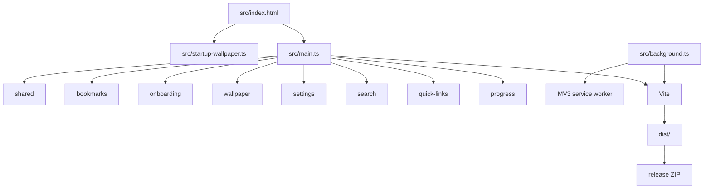

# MarkStart 工程索引

## 项目愿景

MarkStart 是 Chrome/Edge 的 MV3 新标签页扩展：将书签、搜索、快捷链接、壁纸和设置集中在一个可定制页面中。页面源码由严格 TypeScript 和 Vite 构建；发布产物仅为 `dist/` 中的 JavaScript 扩展文件。

## 架构总览

## 模块索引

| 模块 | 职责 | 入口/索引 |
| --- | --- | --- |
| [书签](src/features/bookmarks/AGENTS.md) | 书签树、固定目录、排序、默认目录和手势 | `src/features/bookmarks/page.ts` |
| [快捷链接](src/features/quick-links/AGENTS.md) | 固定站点、黑名单与历史渲染常用站点，含菜单、二维码与缓存 | `src/features/quick-links/index.ts` |
| [搜索](src/features/search/AGENTS.md) | 内置与自定义引擎、下拉与建议、跨引擎临时标签 | `src/features/search/dropdown.ts` |
| [设置](src/features/settings/AGENTS.md) | 设置侧栏、偏好项与外观/布局交互 | `src/features/settings/index.ts` |
| [壁纸](src/features/wallpaper/AGENTS.md) | 预设、上传、Bing 与纯色背景、首帧预览和持久化 | `src/features/wallpaper/index.ts` |
| [欢迎与提示](src/features/onboarding/AGENTS.md) | 分时段或自定义欢迎语、功能提示 | `src/features/onboarding/*.ts` |
| [年度进度](src/features/progress/AGENTS.md) | 页面底部年度进度 | `src/features/progress/index.ts` |
| [共享](src/shared/AGENTS.md) | 国际化、favicon、内联图标、全局声明和类型 | `src/shared/*.ts` |
| [测试](tests/AGENTS.md) | Node 测试、构建与发布包契约 | `tests/*.test.ts` |
| [打包](scripts/AGENTS.md) | 发布 ZIP 创建 | `scripts/package-extension.ts` |

## 运行与开发

- 要求 Node.js 20.19+ 或 22.12+；依赖锁定于 `package-lock.json`。
- `npm run dev`：Vite watch 构建；在 Chrome/Edge 以 `dist/` 加载已解压扩展。
- `npm run build`：生成 MV3 可加载目录 `dist/`。
- `npm run package`：先构建，再生成 `release/MarkStart-<version>.zip`。
- `manifest.json` 对外入口保持 `src/index.html` 与 `src/background.js`；不要将 TypeScript 源文件写入发布包。
- `src/startup-wallpaper.ts` 经 `vite-plugin-static-copy` 复制为 `src/startup-wallpaper.js`，由 `src/index.html` 以 `<script vite-ignore>` 在模块入口之前执行，负责首帧绘制已保存壁纸。
- `images/**` 的静态复制带排除清单，只拷贝运行时引用的图片；新增资源前先确认源码或本地化文案是否引用。
- 构建期把 `console.log/debug/info` 调用点替换为空操作（保留 `warn`/`error`）；调试 watch 产物时设 `MS_KEEP_CONSOLE=1` 保留日志。

## 测试策略

- `npm test`：运行 `tsx --test` 测试集合。
- `npm run typecheck`：严格检查 `src/`、`tests/`、`scripts/` 和 `vite.config.mts`。
- 页面/服务 worker 改动：运行 `npm run build`，并在真实扩展页验证受影响交互。
- 发布流程改动：运行 `npm run package`；测试必须在临时目录验证 ZIP，不污染本地 `dist/` 或 `release/`。

## 编码规范

- TypeScript 为严格模式：不用 `any`、类型断言、非空断言、`@ts-ignore` 或 `@ts-expect-error`。
- 在 Chrome API、storage、消息和外部数据边界以 `unknown` 接收并窄化；类型导入使用 `import type`。
- `src/main.ts` 的副作用导入顺序是页面初始化契约；移动功能文件时同步更新入口与相关测试。
- 优先最小职责模块；DOM/Chrome 控制器与可单测的纯数据逻辑分离，避免无必要抽象。
- 页面样式入口是 `src/styles.less`：按原 styles.css 规则顺序连续切分为 `src/styles/*.less`（功能域文件 + `variables.less` 色板），import 顺序即级联顺序，不可随意重排（存在 `body,main` transition 覆盖链等同特异性依赖）；高频色值必须走 `variables.less` 变量。`output.css` 是提交进仓库的 Tailwind 生成产物，仍由 `index.html` 单独引入。

## AI 使用指引

- 先读本文件，再读目标模块的 `AGENTS.md`。
- 尊重未提交改动与 `dist/`、`release/` 忽略规则；未经用户要求不暂存、提交、推送或删除文件。
- 修改扩展行为时，以现有 MV3 页面行为为兼容基线；纯路径重组也要复核 `main.ts`、入口测试与构建产物。

## 索引状态
- 上次索引：2026-10-20T02:51:59Z
- 基线提交：9d3ed85026d0e43fa179c5f4fca204409e1ecc92
- 已知缺口：无
- 扫描进度：已完成
